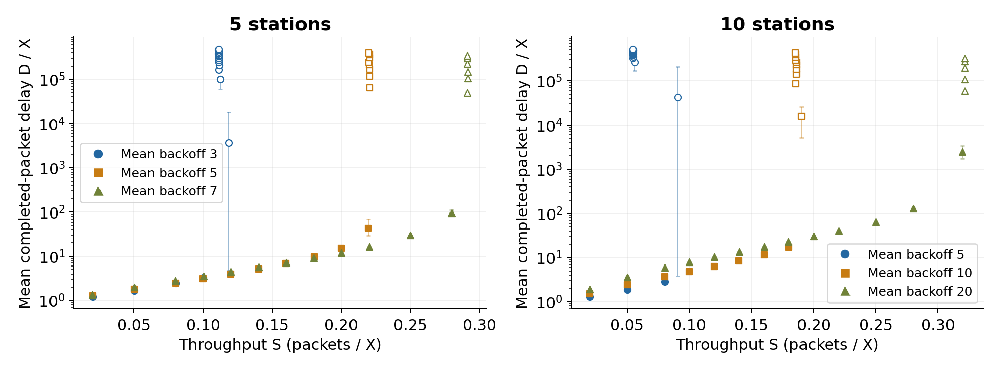
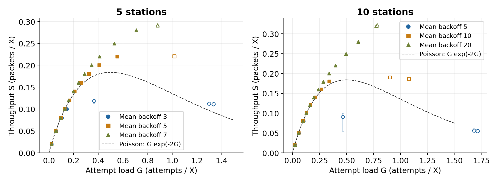
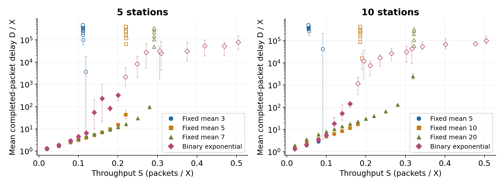
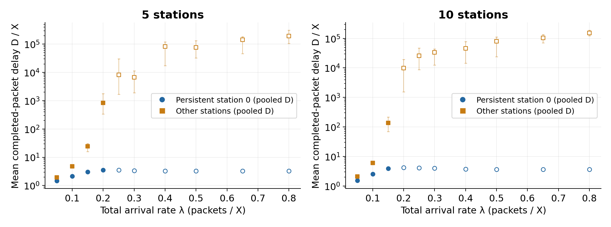
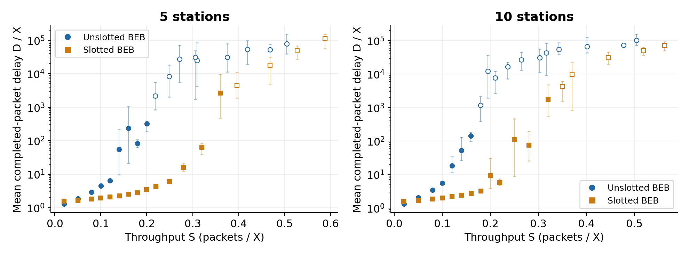
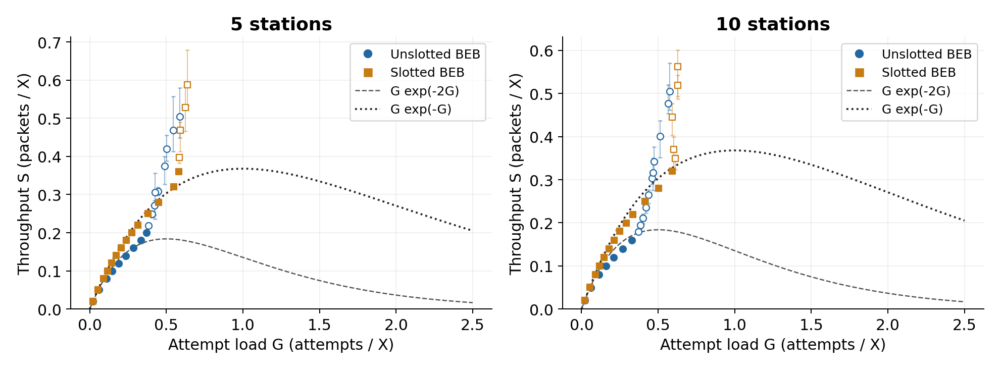
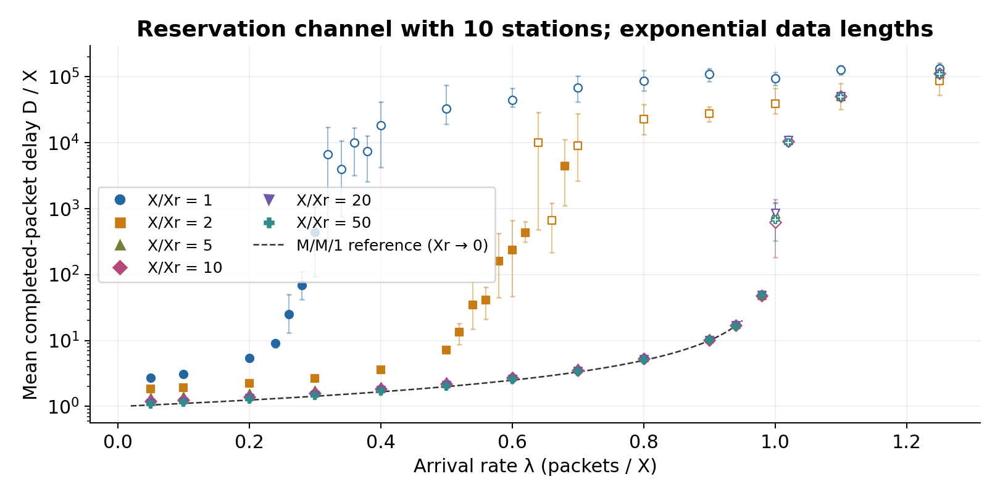

# Computer Engineering 4DK4 — Lab 3

## ALOHA Medium Access Control and Packet Reservation

Student ID / required random seed: 400452897. Group members: Daniel Chirackal and Ryan Phiby Mathew. Experiments completed 26 October 2026. All results in this report were generated by the accompanying simulator; no illustrative or fabricated observations are included.

## Main findings

Longer fixed-mean backoff reduces collision congestion at moderate and high offered load, but adds delay at low load. With 10 stations at λ = 0.1, mean backoff 10 gives D = 4.81 X; mean backoff 20 gives D = 8.06 X. The shorter mean of 5 can enter a congested state even at this rate. Binary exponential backoff limits repeated contention, but its uncapped windows create long delays and capture effects. It does not uniformly improve delay.

Making station 0 persistent produces a strong delay advantage. With 10 stations and λ = 0.3, its mean delay is 3.97 X, compared with 33.3k X for the other stations. Slotted operation reduces the vulnerable period and substantially improves ordinary-load performance. Reservation with short minislots approaches a work-conserving exponential-service data channel: at X/Xr = 10 and λ = 0.9, D = 10.15 X and S = 0.899 packets/X.

The largest observed throughput is not a stability guarantee. Some runs serve packets rapidly while queues grow or individual stations wait extremely long. The report therefore retains overload results, identifies flow imbalance, and includes seed variability and run-length checks.

# 1. Experimental setup and model

The supplied C project and Simlib event scheduler are the starting point. The added lab/simulator.c replaces the fixed-parameter main program for these experiments and links against the unchanged simlib.c, simlib.h and trace.h. The original sources remain available as a baseline. A command-line configuration replaces repeated source edits and recompilation. Compilation uses GCC 14.2.0, GNU C17, optimization -O2 and warning flags -Wall -Wextra -Wpedantic.

| Parameter | Setting |
| --- | --- |
| Time normalization | Mean data packet duration X = 1; all times in units of X |
| Stations | N = 5 and 10; reservation experiments use N = 10 |
| Arrivals | One aggregate Poisson process of rate λ; each arrival independently selects a station uniformly, hence λ/N per station |
| Buffers | Infinite FCFS FIFO per station; at most one contention packet per station |
| Seeds | 400452897, 333333, 222222, 44444, 987654321 |
| Main replications | 1,000,000 X total time; first 100,000 X excluded from measurement; initially empty |
| Main sample size | 305 configurations × 5 seeds = 1,525 independent replications |
| Sensitivity | 12 configurations × 3 run lengths × 5 seeds = 180 further replications |
| ALOHA payloads | Deterministic duration X = 1, as in supplied get_packet_duration() |
| Reservation data payloads | Independent exponential lengths with mean X = 1 |
| Guard time | ε = 10⁻⁷ X on each side of slot boundaries |
| Losses and limits | No buffer limit, retry limit, or intentional packet dropping |

## 1.1 Backoff and timing choices

The handout introduction describes exponentially distributed fixed-mean backoff, but the checked-in packet_transmission.c actually uses 2 × U × MEAN_BACKOFF_DURATION, a uniform distribution. Parts 1–2 here follow the handout distribution: B = −b ln(U), so E[B] = b. This difference is explicit because it changes congested-state behavior. The supplied original program can still be compiled separately to reproduce its uniform-backoff behavior; those original results are not mixed into these curves.

For binary exponential backoff (BEB), a packet with Nc collisions draws B = U × 2^Nc X. There is no Ethernet retry limit or window cap: the lab specifies the uncapped rule. The initial attempt is immediate in unslotted modes. After success, a waiting next packet at that station can start immediately. All overlapping transmissions collide; no physical-layer capture or channel errors are modeled. The word “capture” later refers to MAC unfairness caused by backoff, not reception of a stronger overlapping signal.

Part 4 keeps the other stations unslotted with BEB, as in Part 3. The singled-out station 0 retries at the next integer X boundary after a failed packet ends, plus ε, without random backoff. The phrase “next slot” is otherwise ambiguous before Part 5 introduces slotted operation; this convention gives the requested persistent behavior without silently changing all stations to S-ALOHA. At most one packet per station transmits at a time.

For S-ALOHA, slot k occupies [kX, (k+1)X). Transmissions begin at kX + ε and end at (k+1)X − ε. A fresh head-of-line packet uses the next available boundary. After Nc collisions the retry waits K = floor(U × 2^Nc) whole slots after the next boundary, making K uniform on {0, …, 2^Nc − 1}. This discrete version of BEB includes retry in the immediately following slot when K = 0. Guard-time occupancy loss is 2ε/X = 2 × 10⁻⁷, negligible here. For the shortest reservation minislots (Xr = 0.02 X), the fractional guard loss is 10⁻⁵, or 0.001%.

The reservation and data channels operate concurrently and independently. Reservation minislots have duration Xr and the same absolute guard ε. Only a station’s head-of-line packet contends. Fresh reservations use the next minislot; failed reservations use the same integer-window BEB measured in minislots. A successful reservation removes the packet from the station FIFO and appends it to one shared FCFS data FIFO. The station can then reserve its next packet while earlier packets await or receive data service. Thus there is no one-outstanding-data-packet limit. The data channel sends exactly one packet at a time and is otherwise work-conserving. No acknowledgments or processing delays are added.

## 1.2 Metrics, measurement window and interpretation

Let Tm = T − Tw be the measurement interval, C its completed data packets, A its arrivals and H its transmission starts (including retries). Measured throughput is S = C/Tm packets/X. Aggregate attempt load for the ALOHA curves is G = H/Tm attempts/X, equal to offered airtime per unit time for unit-duration packets up to the negligible guard correction. λ counts new arrivals; G counts every attempt and is not interchangeable with λ. The reservation load column counts reservation attempts per X; multiply it by Xr when interpreting normalized reservation airtime.

Mean delay is D = sum(tdeparture − tarrival)/C for packets departing during the measurement interval, including waiting, collisions, backoff, reservation and data queueing as applicable. Pre-warmup arrivals that depart after warmup are included. This departure-window estimator is appropriate in equilibrium; under overload it is a finite-window completed-packet mean and excludes unfinished packets. It can understate the delay of packets left waiting. Per-station throughput is Ci/Tm. The plotted “other stations” throughput is their mean per-station throughput; their delay pools completed packets within each replication before averaging seeds.

Packet conservation is checked in every run: A − C = Q(T) − Q(Tw), with Q including station queues and, for reservation, the central data queue and packet in service. Queue growth is ΔQ/Tm. Filled markers mean all five seeds have |ΔQ/Tm| ≤ 0.01λ. Hollow markers fail this descriptive flow-balance screen. Reservation λ ≥ 1 is always shown as nonbalanced because the data server is critically loaded or overloaded. Filled markers are not proof of stationarity or finite mean delay; long-run sensitivity is examined separately.

Points are arithmetic means of five per-seed estimates. Vertical whiskers span the minimum and maximum seed estimates, not confidence intervals. Between-seed spread is retained because BEB produces heavy tails; an ordinary five-sample normal interval would give misleading precision in these cases. No simulated data points are joined by piecewise-linear interpolation or a fitted smoothing curve. Dashed or dotted continuous curves are analytical references only. Delay axes use logarithmic scales to show both ordinary and overloaded regimes.

## 1.3 Parameter sweeps

For Parts 1–3 and 5, λ ∈ {0.02, 0.05, 0.08, 0.10, 0.12, 0.14, 0.16, 0.18, 0.20, 0.22, 0.25, 0.28, 0.32, 0.36, 0.40, 0.50, 0.65, 0.80}. Fixed means are {5, 10, 20} for N = 10 and {3, 5, 7} for N = 5. Part 4 uses λ ∈ {0.05, 0.10, 0.15, 0.20, 0.25, 0.30, 0.40, 0.50, 0.65, 0.80} with both station counts.

Reservation ratios X/Xr ∈ {1, 2, 5, 10, 20, 50}. All ratios use λ ∈ {0.05, 0.10, 0.20, 0.30, 0.40, 0.50, 0.60, 0.70, 0.80, 0.90, 1.00, 1.10, 1.25}. Additional points locate transitions: ratio 1 uses {0.24, 0.26, 0.28, 0.32, 0.34, 0.36, 0.38}; ratio 2 uses {0.52, 0.54, 0.56, 0.58, 0.62, 0.64, 0.66, 0.68}; ratios 5, 10, 20 and 50 use {0.94, 0.98, 1.02}.

# 2. Parts 1–2: fixed-mean backoff

Figure 1 shows the delay–arrival-rate curves, and Figure 2 shows the corresponding throughput. Light-load delay is close to one packet time, with collision and queueing delays increasing as λ rises. Shorter mean backoff minimizes waiting after occasional collisions, but too many simultaneous retriers can drive the network into a congested state. Increasing b reduces attempt intensity and postpones this congestion, at the cost of longer waits whenever collisions do occur. The best mean therefore depends on both N and offered load.


Figure 1. Mean delay D versus aggregate arrival rate λ. All requested station counts and fixed means are included. Whiskers show five-seed ranges; hollow points are not flow-balanced. These high-delay points are finite-window measurements, not equilibrium delay curves.


Figure 2. Throughput S versus arrival rate λ for fixed-mean exponential backoff. A stable operating region tracks S ≈ λ; flattening or falling throughput while λ rises indicates queue accumulation and congestion.

| N | Mean b | Largest flow-balanced tested λ | D at that λ / X |
| --- | --- | --- | --- |
| 5 | 3 | 0.10 | 3.28 |
| 5 | 5 | 0.22 | 43.51 |
| 5 | 7 | 0.28 | 94.51 |
| 10 | 5 | 0.08 | 2.84 |
| 10 | 10 | 0.18 | 16.89 |
| 10 | 20 | 0.32 | 2483.17 |

These grid-dependent edges are descriptive, not precise capacities. For 10 stations, b = 5 remains flow-balanced through λ = 0.08, b = 10 through 0.18, and b = 20 through 0.32. For 5 stations the corresponding tested edges are 0.10, 0.22 and 0.28 for b = 3, 5 and 7. At N = 5 and λ = 0.20, D falls from 15.17 X at b = 5 to 12.02 X at b = 7. At N = 10 and λ = 0.10, increasing b from 10 to 20 instead increases delay from 4.81 X to 8.06 X. A single backoff mean does not optimize both light-load latency and congestion resistance.

Figure 3 combines the preceding measurements to plot D against achieved S. In the balanced region, S ≈ λ, so the curve describes increasing queueing delay as carried traffic increases. Congested points may have lower S and much greater D, so D is not necessarily a single-valued function of throughput. Those points must not be interpreted as a second stable operating branch.



Figure 3. Mean delay D versus achieved throughput S for the six fixed-backoff configurations. Points retain their offered-rate identity in summary.csv; no interpolation is used.

## 2.1 Comparison with the conventional lecture ALOHA curve

For a Poisson attempt process of rate G and deterministic unit packet length, an unslotted packet succeeds if no other start falls within a vulnerable interval of length 2X. Hence Psuccess = exp(−2G), S = G exp(−2G), and the maximum is 1/(2e) ≈ 0.184 at G = 0.5. The supplied lecture slides are not attached, so the comparison in Figure 4 uses this conventional formula rather than claiming to have inspected the class figure.



Figure 4. Throughput S versus total attempt load G. The dashed curve is the ideal Poisson-attempt pure-ALOHA result S = G exp(−2G), not a fitted simulation curve.

Both the analytical reference and simulations show that retransmission load is costly: extra attempts can create collisions without comparable delivered traffic. However, the simulations do not lie on one universal Poisson curve, and some finite-station results exceed its 0.184 peak. This model has buffered finite sources, only one active packet per station, state-dependent retries, and immediate service of the next queued packet after a success. Successes can occur in runs, while other stations back off. The superposed attempt process is therefore not Poisson, even though the new arrivals are Poisson and fixed retry waits are exponential. These correlations change the vulnerable-period no-arrival probability. Backoff, station count and saturation can consequently produce different S at comparable G. The Poisson maximum is a benchmark under its assumptions, not a universal physical capacity bound for these finite buffered models.

# 3. Part 3: binary exponential backoff



Figure 5. D versus S with binary exponential backoff, compared with all requested fixed means. Both station counts are shown. Long-delay or unbalanced BEB points are finite-window outcomes.

BEB reacts to repeated failures: after Nc collisions its uniform window has mean 2^(Nc−1) X. This reduces the attempt rate of repeatedly colliding packets. It also creates a disadvantage for a station that has already experienced many collisions, while newly successful stations begin their next packets with no collision history. This creates MAC capture and very long waiting times, despite reasonably high aggregate delivered traffic.

For N = 10 at λ = 0.10, BEB gives S = 0.1001 and D = 5.51 X, between fixed means 10 and 20 in delay. At λ = 0.20, fixed b = 20 gives D = 30.25 X and is flow-balanced; BEB gives D = 12.4k X and some seeds accumulate queues. With N = 5 at λ = 0.20, BEB is flow-balanced over this window but D = 326.59 X, compared with 15.17 X and 12.02 X for fixed b = 5 and 7. Thus BEB’s congestion adaptation is not a guarantee of good latency in this uncapped version. At higher rates it can exceed the conventional Poisson throughput maximum through capture, while individual queues deteriorate. A capped Ethernet window or retry limit would be a different experiment and is not introduced here.

# 4. Part 4: one persistent station



Figure 6. Delay of persistent station 0 and the completion-weighted delay of the remaining stations under BEB. Whiskers show the five-seed range; the background protocol remains unslotted.


Figure 7. Per-station throughput of persistent station 0 and mean per-station throughput of all other stations. The dashed line λ/N is the common offered rate per station, not a theoretical access-capacity curve.

| N at λ = 0.30 | Station group | S per station | Mean D / X | Across-seed D range |
| --- | --- | --- | --- | --- |
| 5 | Persistent station 0 | 0.05992 | 3.32 | 3.17–3.46 |
| 5 | Other stations | 0.05089 | 6650.85 | 1899.54–11255.43 |
| 10 | Persistent station 0 | 0.02999 | 3.97 | 3.85–4.14 |
| 10 | Other stations | 0.02784 | 33342.28 | 12672.35–44155.41 |

Station 0 consistently re-enters contention soon after failure while its competitors can draw exponentially expanding windows. At λ = 0.30 with 10 stations, its D is 3.97 X versus 33.3k X for the others; it delivers about 0.02999 packets/X, close to its offered 0.03, while the others average 0.02784 each. With 5 stations it delivers 0.05992 versus 0.05089 for each other station, with D = 3.32 X versus 6.65k X. The delay advantage is more striking than the throughput advantage because at moderate load a station cannot deliver more sustained traffic than it receives. Persistent retransmission improves one queue’s access while worsening fairness; it is not a system-wide performance improvement. Completed-packet means for the disadvantaged group may hide packets still waiting at the observation cutoff.

# 5. Part 5: Slotted ALOHA



Figure 8. Delay versus throughput for slotted BEB and the unslotted BEB from Part 3. Unit slots and ε = 10⁻⁷ X keep guard overhead negligible.


Figure 9. Slotted and unslotted BEB throughput versus new arrival rate. This comparison preserves identical N, λ, seeds and observation durations.

Slot alignment prevents a transmission beginning partway through another packet’s slot, reducing the vulnerable period from 2X to X. In the Poisson-attempt reference model this changes S to G exp(−G), with peak 1/e ≈ 0.368 at G = 1. Fresh arrivals incur an approximately half-slot alignment wait when lightly loaded. As λ → 0, slotted delay approaches about 1.5 X instead of the unslotted limit X; the collision reduction becomes valuable as contention rises.

For 10 stations at λ = 0.10, D is 2.00 X with slots and 5.51 X without slots. At λ = 0.20 the five-seed slotted mean is 9.20 X, versus 12.4k X unslotted; the slotted range is 3.85–30.16 X, showing one long-delay realization rather than tight convergence. For 5 stations at λ = 0.32, slotted BEB carries S = 0.3199 with D = 63.82 X, versus S = 0.3093 and D = 25.2k X unslotted. At higher loads both protocols can exhibit capture, nonstationarity and very long delays. Slotting improves the typical contention regime but does not remove BEB’s tail behavior.



Figure 10. Throughput versus attempt load for both BEB modes. Analytical Poisson curves show the vulnerable-period comparison. Finite buffered BEB results may exceed their maxima because the attempt process is state-dependent and correlated.

# 6. Part 6: separate reservation and data channels



Figure 11. End-to-end data-packet delay versus arrival rate for six X/Xr ratios. N = 10, exponential data lengths and a concurrent FCFS data channel. The dashed M/M/1 reference is D/X = 1/(1 − λX), shown only for λX < 1.

End-to-end delay includes the station queue, slot alignment, reservation attempts and backoffs, and FCFS data waiting and service. Making Xr smaller reduces both the first reservation time and the penalty of failed contention. At light load, a packet waits about Xr/2 for the next boundary, occupies nearly Xr on the reservation channel, and receives mean data service X. Thus D ≈ X + 1.5 Xr as λ → 0. For X/Xr = 1, measured D at λ = 0.05 is 2.73 X; for ratio 50 it is 1.08 X. The small additional delay above the light-load approximation comes from queueing and collisions.

As reservations become fast, the data server becomes the bottleneck. With mean service X = 1 its utilization is approximately λX in the balanced region. For X/Xr = 50 and λ = 0.90, D = 10.07 X, close to the ideal M/M/1 value 10 X. For X/Xr = 10 the measured delay is 10.15 X. This reference becomes appropriate as reservation delay tends to zero and the central input approaches the original Poisson arrivals; it is not assumed exact at finite Xr because reservation departures are correlated.


Figure 12. Delivered data throughput versus λ. Short-minislot configurations approach the data-channel service rate 1/X. Points slightly above 1 reflect finite-sample exponential service variability, not a violation of the long-run service ceiling.

## 6.1 Capacity and its limits

The data channel gives a hard long-run upper bound C ≤ 1/X = 1 packet/X. If reservation attempts were Poisson over minislots, their ideal maximum success rate would be 1/(e Xr), giving the benchmark Cref = min(1/X, 1/(e Xr)). In normalized units this is min(1, (X/Xr)/e). The benchmark is 0.368, 0.736 and 1.000 for ratios 1, 2 and ≥5, respectively. It is not a universal upper bound on this correlated finite-station BEB reservation process; only the data bound remains universal within the model.


Figure 13. Capacity evidence for each ratio: the largest measured seed-mean service rate, largest flow-balanced tested offered rate below the data critical load, and the ideal Poisson reservation benchmark. These are distinct quantities, not interchangeable capacity estimates.

| X/Xr | Poisson benchmark | Max measured mean S | Largest balanced λ | D at balanced edge / X |
| --- | --- | --- | --- | --- |
| 1 | 0.368 | 0.703 | 0.30 | 435.13 |
| 2 | 0.736 | 0.977 | 0.68 | 4379.34 |
| 5 | 1.000 | 1.000 | 0.98 | 48.73 |
| 10 | 1.000 | 1.001 | 0.98 | 47.18 |
| 20 | 1.000 | 1.001 | 0.98 | 48.74 |
| 50 | 1.000 | 1.000 | 0.98 | 49.10 |

With ratios 5 and above, tested rates through 0.98 are flow-balanced, whereas λ = 1 is critical and λ > 1 grows queues; the observations locate the practical data-limited capacity near 1 packet/X without claiming finite delay at the boundary. At ratio 1, the largest flow-balanced tested rate is 0.30, but D already averages 435 X there. At ratio 2 the analogous rate is 0.68 with D ≈ 4.38k X. These are poor delay operating points and their balance is not proof of a well-behaved steady state. High-load capture produces larger measured service rates than these flow-balanced rates, while queues grow, so peak observed throughput must not be reported as sustainable capacity. A fair service guarantee or a prescribed delay target would produce a lower usable-load limit, especially for the long-minislot configurations.

# 7. Simulation accuracy and validation

Every main configuration uses five independent replications with 900,000 X of measured time each. The chosen common seed list includes the required student-ID seed. Using the same seed across configurations makes reruns reproducible, but random streams diverge with different event paths; the analysis does not assume an exact paired common-random-number comparison. Results depend on the supplied libc rand()-based Simlib generator, so bitwise reproduction is tied to the recorded toolchain and platform.

Twelve selected configurations were rerun for total horizons 300,000 X, 1,000,000 X and 5,000,000 X, always discarding the first 10%. They cover fixed means 5 at λ = 0.08, 10 at λ = 0.18 and 20 at λ = 0.25; unslotted BEB at λ = 0.10, 0.20 and 0.40; slotted BEB at λ = 0.20 and 0.40; and reservation at (λ, X/Xr) = (0.30, 1), (0.60, 2), (0.90, 10) and (1.00, 10), all with 10 stations. Five seeds per case yield 180 sensitivity replications.


Figure 14. Run-length sensitivity of completed-packet mean delay. Whiskers show seed ranges. Filled points satisfy the flow-balance screen but can still show substantial variation with duration. The fixed-backoff sensitivity results are included in sensitivity_summary.csv.

| Configuration (N = 10) | D at 0.3M X | D at 1M X | D at 5M X |
| --- | --- | --- | --- |
| Fixed b = 5, λ = 0.08 | 2.84 | 2.84 | 2.85 |
| Fixed b = 10, λ = 0.18 | 16.71 | 16.89 | 17.32 |
| Fixed b = 20, λ = 0.25 | 64.81 | 65.61 | 65.77 |
| BEB, λ = 0.20 | 4,696.83 | 12,386.78 | 22,841.17 |
| Slotted BEB, λ = 0.20 | 3.81 | 9.20 | 4.10 |
| Reservation X/Xr = 2, λ = 0.60 | 289.47 | 235.30 | 869.59 |
| Reservation X/Xr = 10, λ = 0.90 | 10.38 | 10.15 | 10.38 |
| Reservation X/Xr = 10, λ = 1.00 | 430.36 | 623.43 | 1,302.02 |

The ordinary-load fixed-backoff examples and short-minislot reservation at λ = 0.9 show relatively consistent estimates as duration increases. In contrast, unslotted BEB at λ = 0.2 has five-seed mean delay increasing from 4.70k X to 22.8k X. The slotted λ = 0.2 mean changes nonmonotonically because a rare large delay dominates one finite run. Reservation at λ = 0.6 with ratio 2 can pass the balance check at all three lengths while its measured delay remains highly variable. At the critical data load λ = 1, increasing delay with horizon confirms that throughput near 1 does not imply finite stationary delay. The appropriate conclusions in these cases concern observed finite-horizon service, unfairness and variability, not an accurately estimated limiting mean.

The accompanying test_simulator.py passes 19 model, repeatability, overload and argument checks. Single-station unslotted results match the M/D/1 mean D/X = 1 + λ/[2(1 − λ)] at λ = 0.2 within 0.025 X. Single-station slotted results match D/X = 1.5 + λ/[2(1 − λ)] at the same rate and have zero collisions. Reservation at Xr = 0.0001 and λ = 0.2 approaches M/M/1 mean 1.25 X within 0.03 X. Every tested run checks exact packet conservation and reconciles per-station completions. Internal assertions check slot alignment, single active transmission per station, and nonnegative service-inclusive delay. These tests validate implementation invariants and limiting cases; they do not prove statistical convergence under heavy-tailed BEB.

Limitations: no finite-buffer losses, propagation delays, acknowledgments, physical errors or power capture are modeled. Conclusions apply to the explicitly stated retry and reservation-pipelining rules. Departures before the cutoff do not reveal the ultimate delays of unfinished packets. Five-seed ranges describe observed variability and are not formal coverage intervals. The exact lecture slide curve was unavailable, and its conventional analytical counterpart was derived above. No course submission or instructor approval is asserted.

# 8. Reproducibility and source references

Primary specification: coe4dk4_lab_3_2026.pdf, pages 1–3 (preparation, six experiment groups and writeup requirements), with page 4 rubric. Code baseline: chirackd/4DK4-Lab-3, main checkout at commit 7a13b2e (full revision and source checksums are recorded in results/provenance.json). Queueing and ALOHA formulas are analytical checks derived for the stated ideal models, not additional simulated observations.

From the repository root, run the following. The results CSVs are the authoritative observations; analyze.py generates summaries and 14 figures in both PNG and vector PDF. build_report.py produces this PDF and an equivalent Markdown writeup from one content definition. The supplied original source files are not edited; all additions are under lab/.

```
make -C lab
python3 lab/test_simulator.py
python3 lab/run_experiments.py --time 1000000 --seeds 400452897 333333 222222 44444 987654321 --workers 4
python3 lab/run_sensitivity.py
python3 lab/analyze.py
python3 lab/build_report.py
```

| Artifact | Purpose |
| --- | --- |
| lab/simulator.c and lab/Makefile | Added configurable C implementation and build target |
| lab/run_experiments.py; lab/run_sensitivity.py | Main parameter grid and horizon sensitivity |
| lab/test_simulator.py | Analytical, flow-conservation and reproducibility checks |
| lab/results/runs.csv; stations.csv | 1,525 raw replication records and station-level outputs |
| lab/results/summary.csv; fairness.csv; capacity.csv | Aggregated plotted results and capacity evidence |
| lab/results/sensitivity.csv; sensitivity_summary.csv | 180 long/short-horizon replications and summaries |
| lab/results/provenance.json; manifest.json | Source hashes, versions, seed list and run settings |
| lab/figures/ | All 14 plots, PNG and vector PDF |
| lab/REPORT.md; Lab_3_Report.pdf | Editable writeup and PDF |

# Appendix A. Added simulation code

The following is the complete added driver, lab/simulator.c. It reuses the supplied Simlib scheduler, event structures and RNG. No unchanged supplied code is reproduced. The source file in the bundle is the authoritative compilable version; long lines may wrap in this typeset appendix.

```
/* Lab 3 replacement driver using the supplied Simlib event engine and RNG.
 * Original supplied sources are retained for comparison. */
#include <stdio.h>
#include <stdlib.h>
#include <stdint.h>
#include <string.h>
#include <math.h>
#include <assert.h>
#include "simlib.h"

typedef struct Packet Packet;
struct Packet { double arrival, duration; unsigned collisions; int station, collided; Packet *next; };
typedef struct { Packet *head,*tail; unsigned long queued, departed; double delay; } Station;
static Station st[100];
static int n=10, persistent=-1, active=0, data_busy=0;
static const char *mode="fixed";
static double rate=.1, backoff=10, horizon=200000, warmup=20000, xr=.1;
static const double guard=1e-7;
static unsigned seed=333333;
static unsigned long attempts=0, successes=0, arrivals=0, reserved=0, backlog_warm=0;
static double delay_sum=0, collisions_sum=0, data_work=0;
static Packet *air[100], *data_head=NULL,*data_tail=NULL;
static Simulation_Run_Ptr sim;
static double now(void) { return simulation_run_get_time(sim); }
static int reservation(void) { return !strcmp(mode,"reservation"); }
static int slotted(void) { return reservation() || !strcmp(mode,"slotted"); }
static double uniform(void) { double u=uniform_generator(); return fmax(1e-12,fmin(1-1e-12,u)); }
static double exponential(double mean) { return -mean*log(uniform()); }
static void schedule(void (*fn)(Simulation_Run_Ptr,void*),void *p,double t) {
  assert(isfinite(t) && t>=now()-1e-9);
  Event e={"lab3",fn,p}; simulation_run_schedule_event(sim,e,t);
}
static void start(Simulation_Run_Ptr,void*);
static void finish(Simulation_Run_Ptr,void*);
static void data_finish(Simulation_Run_Ptr,void*);
static void activate(Packet *p,double earliest) {
  double slot=reservation()?xr:1;
  double t=slotted()?ceil(earliest/slot-1e-10)*slot+guard:earliest;
  schedule(start,p,t);
}
static void enqueue(Station *s,Packet *p) {
  p->next=NULL; if(s->tail) s->tail->next=p; else s->head=p;
  s->tail=p; s->queued++;
}
static void pop(Station *s) { assert(s->head); s->head=s->head->next; if(!s->head)s->tail=NULL; s->queued--; }
static void data_start(void) {
  if(!data_busy && data_head) { data_busy=1; schedule(data_finish,data_head,now()+data_head->duration); }
}
static void record(Packet *p) {
  if(now()>=warmup) {
    double d=now()-p->arrival; assert(d>=p->duration-2*guard-1e-8);
    successes++; delay_sum+=d; collisions_sum+=p->collisions;
    st[p->station].departed++; st[p->station].delay+=d;
    data_work+=p->duration;
  }
}
static void data_finish(Simulation_Run_Ptr s,void *v) {
  (void)s; Packet *p=v; assert(p==data_head); record(p);
  data_head=p->next; if(!data_head)data_tail=NULL; free(p); data_busy=0; data_start();
}
static void arrival(Simulation_Run_Ptr s,void *v) {
  (void)s;(void)v;
  int id=(int)(uniform()*n); Packet *p=calloc(1,sizeof(*p)); assert(p);
  p->station=id; p->arrival=now(); p->duration=reservation()?exponential(1):1;
  int idle=!st[id].head; enqueue(&st[id],p);
  if(now()>=warmup)arrivals++;
  if(idle)activate(p,now());
  schedule(arrival,NULL,now()+exponential(1/rate));
}
static void start(Simulation_Run_Ptr s,void *v) {
  (void)s;Packet *p=v; assert(air[p->station]==NULL);
  if(slotted()) { double slot=reservation()?xr:1;
    assert(fabs((now()-guard)/slot-round((now()-guard)/slot))<1e-5); }
  air[p->station]=p;
  p->collided=active>0;
  if(active)for(int i=0;i<n;i++)if(air[i])air[i]->collided=1;
  active++; assert(active<=n); if(now()>=warmup)attempts++;
  double duration=reservation()?xr-2*guard:(slotted()?1-2*guard:1);
  schedule(finish,p,now()+duration);
}
static void finish(Simulation_Run_Ptr s,void *v) {
  (void)s; Packet *p=v; Station *q=&st[p->station];
  assert(air[p->station]==p);air[p->station]=NULL;active--;
  if(p->collided) {
    p->collisions++;
    if(p->station==persistent) {
      /* Part 4: next unit boundary, even though other stations are unslotted. */
      schedule(start,p,ceil(now()-1e-10)+guard);
    } else {
      double b;
      if(!strcmp(mode,"fixed"))b=exponential(backoff);
      else {
        /* No artificial Ethernet retry cap: lab specifies [0,2^Nc). */
        double window=ldexp(1.0,(int)fmin(p->collisions,1024));
        /* Overflow to infinity means no retry within this finite horizon. */
        b=uniform()*window*(reservation()?xr:1);
        if(slotted()) {
          double slot=reservation()?xr:1;
          double next=ceil(now()/slot-1e-10)*slot;
          double t=next+floor(b/slot)*slot+guard;
          if(t<=horizon)schedule(start,p,t);
          return;
        }
      }
      if(b>horizon-now())return; /* Retry lies beyond observation window. */
      activate(p,now()+b);
    }
  } else {
    pop(q);
    if(reservation()) {
      if(now()>=warmup)reserved++;
      p->next=NULL;if(data_tail)data_tail->next=p;else data_head=p;data_tail=p;data_start();
    } else { record(p);free(p); }
    if(q->head)activate(q->head,now());
  }
}
static unsigned long backlog(void) {
  unsigned long b=0;for(int i=0;i<n;i++)b+=st[i].queued;
  for(Packet *p=data_head;p;p=p->next)b++;
  return b;
}
static void boundary(Simulation_Run_Ptr s,void *v) { (void)s;(void)v;backlog_warm=backlog(); }
static void stop(Simulation_Run_Ptr s,void *v) { (void)s;(void)v; }
int main(int argc,char **argv) {
  for(int i=1;i<argc;i++) {
    if(i+1>=argc){fprintf(stderr,"Every option needs a value\n");return 2;}
    const char *k=argv[i],*v=argv[++i];
    if(!strcmp(k,"--mode"))mode=v;else if(!strcmp(k,"--stations"))n=atoi(v);
    else if(!strcmp(k,"--rate"))rate=atof(v);else if(!strcmp(k,"--backoff"))backoff=atof(v);
    else if(!strcmp(k,"--seed"))seed=(unsigned)strtoul(v,NULL,10);
    else if(!strcmp(k,"--time"))horizon=atof(v);else if(!strcmp(k,"--warmup"))warmup=atof(v);
    else if(!strcmp(k,"--xr"))xr=atof(v);else if(!strcmp(k,"--persistent"))persistent=atoi(v);
    else {fprintf(stderr,"Unknown option %s\n",k);return 2;}
  }
  if(!isfinite(rate)||!isfinite(backoff)||!isfinite(xr)||!isfinite(horizon)||!isfinite(warmup)||n<1||n>100||rate<=0||backoff<=0||xr<=2*guard||horizon<=warmup||warmup<0||persistent>=n||persistent< -1||
     (strcmp(mode,"fixed")&&strcmp(mode,"beb")&&strcmp(mode,"slotted")&&strcmp(mode,"reservation")))return 2;
  random_generator_initialize(seed);sim=simulation_run_new();
  schedule(arrival,NULL,exponential(1/rate));schedule(boundary,NULL,warmup);schedule(stop,NULL,horizon);
  while(now()<horizon)simulation_run_execute_event(sim);
  double t=horizon-warmup;
  printf("mode,stations,rate,backoff,seed,time,warmup,xr,persistent,arrivals,successes,attempts,throughput,load,delay,collisions,backlog_warm,backlog_end,backlog_growth,reserved,data_work_rate\n");
  printf("%s,%d,%.9g,%.9g,%u,%.9g,%.9g,%.9g,%d,%lu,%lu,%lu,%.12g,%.12g,%.12g,%.12g,%lu,%lu,%.12g,%lu,%.12g\n",
    mode,n,rate,backoff,seed,horizon,warmup,xr,persistent,arrivals,successes,attempts,successes/t,attempts/t,
    successes?delay_sum/successes:NAN,successes?collisions_sum/successes:NAN,backlog_warm,backlog(),
    ((double)backlog()-backlog_warm)/t,reserved,data_work/t);
  printf("station,successes,throughput,delay,backlog\n");
  for(int i=0;i<n;i++)printf("%d,%lu,%.12g,%.12g,%lu\n",i,st[i].departed,st[i].departed/t,
    st[i].departed?st[i].delay/st[i].departed:NAN,st[i].queued);
  /* Process exit releases remaining events/packets; each replication is a process. */
  return 0;
}
```

# Appendix B. Build configuration

```
CC = gcc
CFLAGS = -O2 -std=gnu17 -Wall -Wextra -Wpedantic
LDLIBS = -lm

all: simulator
simulator: simulator.c ../simlib.c ../simlib.h ../trace.h
	$(CC) $(CFLAGS) -I.. simulator.c ../simlib.c $(LDLIBS) -o $@
clean:
	rm -f simulator simulator-sanitize
.PHONY: all clean
```
