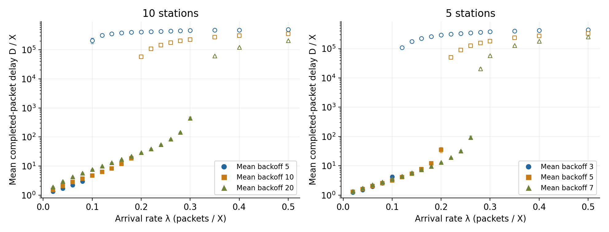
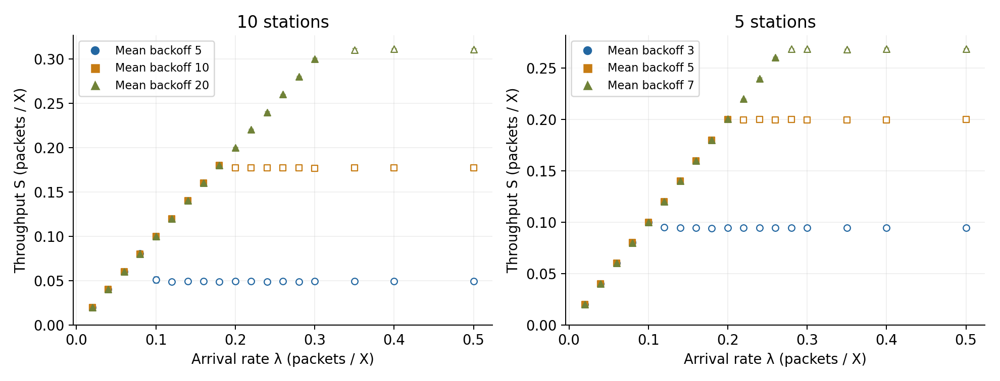
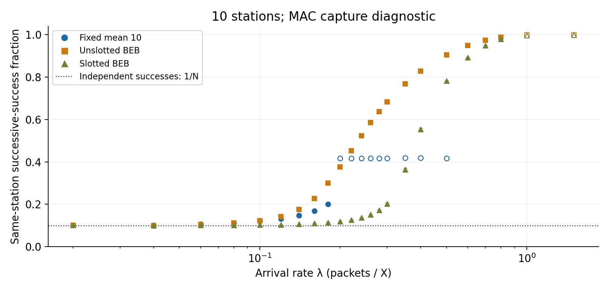
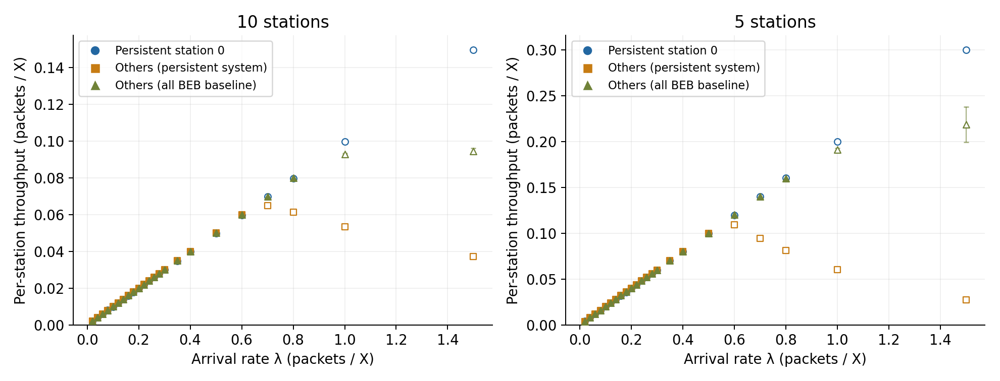
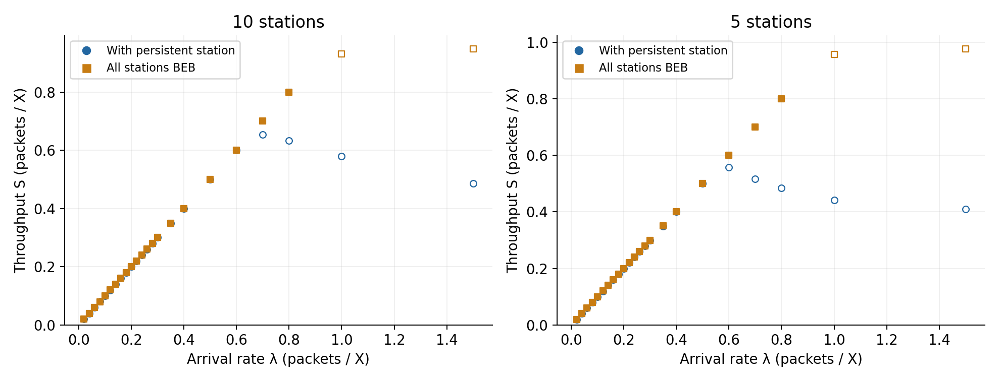
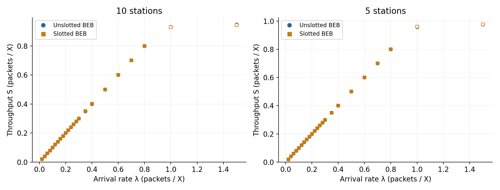
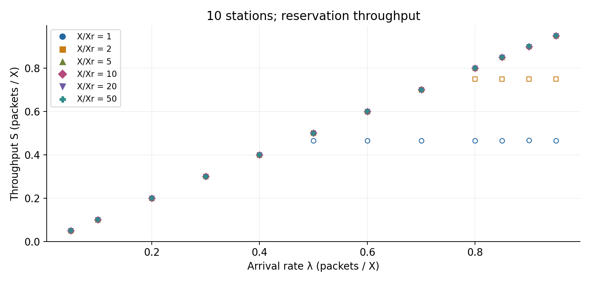
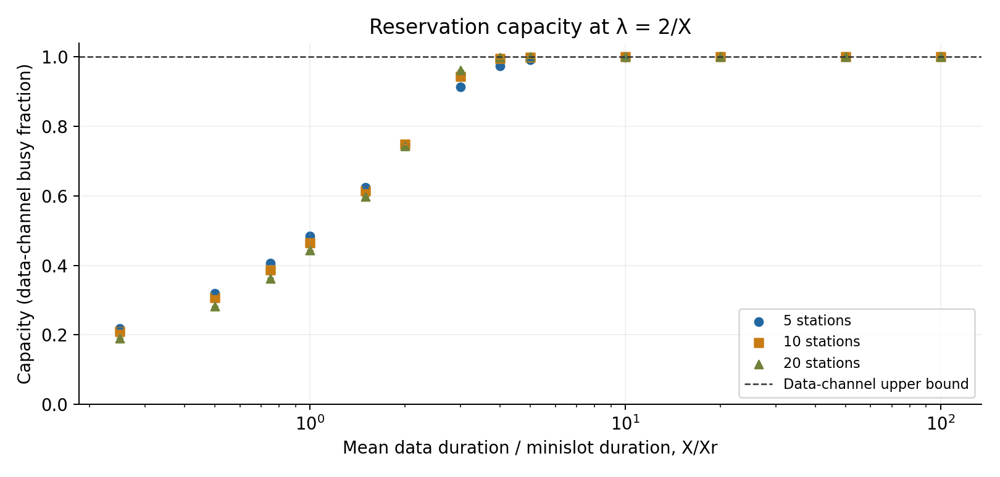
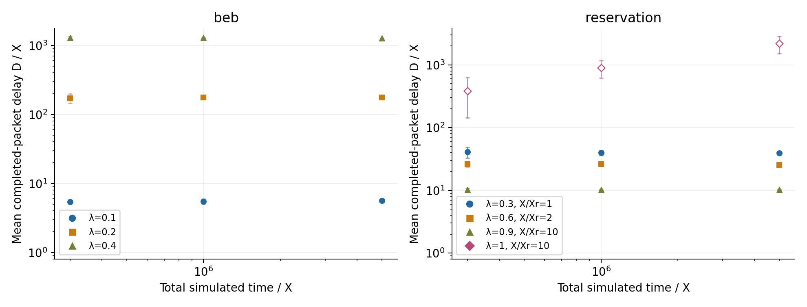

# Computer Engineering 4DK4 — Lab 3

## ALOHA Medium Access Control and Packet Reservation

Group members: Daniel Chirackal and Ryan Phiby Mathew. Required student-ID seed: 400452897. All measurements below come from the accompanying current-run CSVs, not from the supplied comparison report.

# 1. Baseline interpretation and experimental setup

COE4DK4_Lab3_Report.docx was parsed as a conceptual model and graph reference. Its fixed-backoff distribution, BEB cap, persistent retry rule, guard-time convention, single-outstanding reservation rule, and treatment of saturation informed the configuration below. Its authors, student seeds, numerical data, plots, and prose are not substituted for this group’s results. Exact numerical agreement is not expected or required.

| Setting | Current run |
| --- | --- |
| Arrivals and buffers | Aggregate Poisson arrivals λ; uniformly selected station; infinite FIFO per station |
| Packet durations | X = 1 for Parts 1–5; independent exponential data durations with mean X = 1 in Part 6 |
| Random seeds | 44444, 222222, 333333, 400452897, 987654321 |
| Main runs | 1905 replications, 381 parameter configurations |
| Measurement window | Total horizon 1e+06 X; initial 100000 X excluded |
| Fixed backoff | Uniform on [0, 2B), mean B; original supplied C behavior |
| BEB | Uniform on [0, 2^min(Nc, cap)); cap = 10 (0 means uncapped) |
| Persistent station | Station 0 retries immediately after failure; other stations retain unslotted BEB |
| Slotted ALOHA | Payload duration 1; slot duration 1 + 2ε, ε = 0.001; continuous BEB wait then alignment |
| Reservation | One outstanding reservation/data packet per station; integer-minislot BEB; shared FCFS data server |
| Reservation numerical guard | 10⁻⁹ X around minislot boundaries; negligible occupancy cost, separate from ε |
| Model profile | report-aligned-v2; no physical-layer capture, losses, propagation delay or retry limit |

The handout specifies an uncapped BEB range and describes exponential fixed backoff in its introduction. The comparison report deliberately uses the supplied uniform backoff and an Ethernet-like exponent cap of 10. This baseline profile makes that choice explicit; --beb-cap 0 restores uncapped BEB, and --fixed-distribution exponential selects the alternate fixed model. These changes are modeling choices, not graphical corrections.

The reference report stops runs after a target number of completed packets and discards no warmup. This workflow defaults to fixed simulated time with a 10% warmup. Therefore overload delays and variability will differ numerically. Completion-count stopping is supported by --packets, with --time retained as a hard horizon. No dataset is tuned to the reference coordinates.

## 1.1 Measurements and statistical treatment

For measurement time Tm, throughput S = completed data packets / Tm, and direct-ALOHA attempt load G = all transmission starts / Tm. G counts retransmissions and may exceed 1; it is not the union of occupied time. A reservation attempt has duration Xr, so reservation attempted airtime is its attempt rate multiplied by Xr. End-to-end mean delay D averages arrival-to-data-completion times of packets departing in the measurement window. Unfinished packets remain in the backlog and are not counted as completed.

Reservation capacity is measured separately at λ = 2/X as the exact data-channel busy time intersected with the measurement window, divided by Tm. This utilization is bounded by 1 even when finite-window exponential-service packet counts fluctuate above 1 packet/X. The CSV also retains packet throughput and completed payload-work rate; these quantities are not silently interchanged.

All runs check arrivals − completions = backlog_end − backlog_warm. Filled markers pass a descriptive per-seed screen: S ≥ 0.97λ and backlog growth ≤ 0.03λ in every seed. Critical or overloaded reservation λ ≥ 1 is excluded. Hollow points fail the screen. Flow balance is not a proof of stationarity or finite mean delay. Delay-versus-throughput comparisons omit nonbalanced points; delay-versus-arrival plots retain them as finite-window overload measurements.

Points are seed means with two-sided 95% Student-t intervals where at least two independent seeds are available. The default five-seed runs use t(4) = 2.77645. For more than six seeds the implementation conservatively retains the df = 5 critical value rather than inventing narrower intervals. Untruncated numeric interval bounds are saved in the summary CSV. Logarithmic delay plots clip interval portions below the positive axis domain. No piecewise-linear interpolation or fitted smoothing is applied to simulated observations; continuous lines are analytical references only.

# 2. Parts 1–2: fixed mean backoff



Figure 1. Mean delay versus arrival rate, uniform fixed backoff, 10 and 5 stations. Hollow markers indicate flow imbalance and run-length-dependent delay.



Figure 2. Throughput versus arrival rate for all six requested fixed means. The operating knee and saturated service plateau depend on N and B.

| N | Mean backoff B | S at λ = 0.5 | D at λ = 0.1 |
| --- | --- | --- | --- |
| 10 | 5 | 0.0494 ± 0.0002925 | 2.09e+05 ± 4.414e+04 |
| 10 | 10 | 0.1769 ± 0.0002063 | 4.743 ± 0.07751 |
| 10 | 20 | 0.3107 ± 0.001288 | 7.642 ± 0.111 |
| 5 | 3 | 0.09469 ± 0.0003775 | 4.207 ± 0.6362 |
| 5 | 5 | 0.2002 ± 0.0006057 | 3.167 ± 0.02892 |
| 5 | 7 | 0.269 ± 0.0003341 | 3.525 ± 0.0533 |

At light load packets usually succeed on their first attempt and D approaches one packet time. Collisions and FIFO waiting increase delay with λ. A long retry interval adds latency after a rare collision, but reduces synchronized contention among backlogged stations and supports more delivered traffic before congestion. Short backoff can collapse into a low-service state. Saturated delays depend on the observation horizon and must not be described as finite equilibrium delays.


Figure 3. Delay versus carried throughput for flow-balanced configurations only. Shorter backoff can give lower delay while longer backoff can support a higher carried load.


Figure 4. Throughput versus aggregate attempt load. Dashed/dotted lines are Poisson-attempt pure/slotted ALOHA benchmarks, not fitted data.

For independent Poisson attempts the pure-ALOHA vulnerable interval is 2X, giving S = G exp(−2G), maximum 1/(2e). With slot alignment it is X, giving S = G exp(−G), maximum 1/e. Neither peak is a universal bound for these buffered finite-source models. A successful station can immediately send its next queued packet while others back off, making attempt starts correlated. At high load this MAC capture raises S above the conventional Poisson benchmark without physical reception of overlapping packets.

# 3. Part 3: capped binary exponential backoff


Figure 5. Capped BEB against all fixed means, flow-balanced points only. The cap is an explicit reference-profile assumption; uncapped behavior remains available separately.

For N = 10 at λ = 0.2, capped BEB gives D = 176.4 ± 9.552 X and S = 0.2002 ± 0.0007945. At λ = 0.5 it gives D = 1755 ± 36.6 X and S = 0.5 ± 0.0006575. The cap prevents a repeatedly collided packet from waiting for arbitrarily expanding windows. It does not remove contention or guarantee low latency; a well-chosen fixed mean can still have lower delay at moderate carried load.



Figure 6. Same-station successive-success fraction for fixed mean 10, unslotted BEB and slotted BEB, N = 10. The 1/N line is the independent-success reference.

Success bursts grow as traffic increases: a station that has succeeded resets its next packet’s collision history, while unsuccessful competitors keep larger windows. This explains high carried throughput together with long delay and short-term unfairness. The measured repeat fraction supplies evidence for capture rather than attributing every departure from the Poisson curve to a coding error.

# 4. Part 4: immediate persistent retries


Figure 7. Persistent station delay, other-station delay, and the all-BEB comparison system. Other-station delay pools completed packets within each seed.



Figure 8. Persistent station and other stations’ per-station throughputs, with the all-BEB baseline.

At N = 10 and λ = 0.3, persistent station 0 has D = 3.836 ± 0.02867 X, whereas its competitors have pooled D = 812.5 ± 22.18 X. The station retries at the instant its failed transmission ends, without imposing an extra integer-boundary wait. At low load its sustained throughput remains limited by its own arrival rate λ/N; its advantage is mainly delay.



Figure 9. Total system throughput with and without persistence. Immediate retries help one station but reduce high-load total service.

The persistent station disrupts competitors’ attempts and pushes them into larger retry windows. Under high offered traffic they fall below their fair offered share, and total throughput can decline even as offered traffic grows. Comparing only station 0 would conceal this system cost, so the plots retain both per-station and aggregate comparisons.

# 5. Part 5: slotted ALOHA


Figure 10. Slotted and unslotted capped BEB, flow-balanced delay points only. The payload remains X = 1; guard time extends the slot to 1.002 X.



Figure 11. Slotted and unslotted BEB delivered traffic versus new offered traffic.

For N = 10 at λ = 0.2, slot alignment gives D = 4.083 ± 0.2229 X, compared with 176.4 ± 9.552 X without slots. Alignment removes partial overlaps between adjacent slots, reducing the vulnerable period. At extremely light load there is an alignment wait of about half a slot. Guard time is actual overhead: the fully backlogged one-station service ceiling is 1/(1 + 2ε), not 1 obtained by shortening the payload.


Figure 12. Attempt-load comparison with the pure and slotted Poisson analytical curves. Finite-source BEB capture can exceed their conventional peaks.

# 6. Part 6: reservation and collision-free FCFS data


Figure 13. End-to-end delay versus offered rate. Left: N = 10 and six X/Xr ratios. Right: X/Xr = 10 for N = 5, 10, 20. The dashed M/M/1 curve is a limiting reference.

The station’s FIFO head remains there through reservation and data completion; its successor cannot reserve early. A second, independent link is used for the shared FCFS data queue so retaining the station head cannot corrupt either queue. This bounds the total number of reserved/in-service packets by N. Reservation and data channels still operate concurrently across different stations.

Small X/Xr makes the reservation channel the bottleneck, so delay increases sharply at a comparatively low λ. Large X/Xr makes reservations cheap and the exponential data server dominates. As Xr tends to zero, D approaches the M/M/1 expression X/(1 − λX) under the stated traffic model. At light load the reservation adds approximately Xr/2 for boundary alignment plus Xr for the successful minislot.



Figure 14. Delivered data packet rate versus λ for N = 10. Reservation-limited configurations plateau earlier.



Figure 15. Data-channel busy fraction under overload λ = 2/X, for 5, 10 and 20 stations across a broad ratio range. The upper bound is 1.

| X/Xr | Capacity N = 5 | Capacity N = 10 | Capacity N = 20 |
| --- | --- | --- | --- |
| 0.25 | 0.2191 ± 0.001313 | 0.2094 ± 0.0006384 | 0.1906 ± 0.001189 |
| 0.5 | 0.3196 ± 0.000994 | 0.3064 ± 0.0008968 | 0.2826 ± 0.0005815 |
| 1 | 0.4843 ± 0.0008044 | 0.4658 ± 0.0007382 | 0.4431 ± 0.0006219 |
| 2 | 0.7473 ± 0.001082 | 0.7487 ± 0.0009155 | 0.7434 ± 0.0008941 |
| 3 | 0.9142 ± 0.000621 | 0.9443 ± 0.000819 | 0.9621 ± 0.0001731 |
| 4 | 0.9746 ± 0.0004481 | 0.995 ± 0.0002404 | 0.9996 ± 2.968e-05 |
| 5 | 0.9913 ± 9.288e-05 | 0.9994 ± 2.911e-05 | 1 ± 2.946e-06 |
| 10 | 0.9997 ± 4.885e-06 | 1 ± 1.109e-06 | 1 ± 0 |
| 100 | 1 ± 0 | 1 ± 0 | 1 ± 0 |

Capacity increases with packet/minislot ratio and approaches a fully busy data server. For long minislots, additional stations create more reservation contention; when minislots are short, more outstanding stations can keep the data server supplied. The Poisson minislot benchmark 1/e is not a universal finite-source BEB bound. Capacity here is measured at a specified overload rate, not inferred by taking the largest throughput from an arbitrary delay sweep.

# 7. Reliability, validation and limitations



Figure 16. Seed intervals and run-length sensitivity for selected BEB and reservation points. A short run can miss rare contention or critical-load backlog behavior.

| Mode | λ | X/Xr | Horizon / X | Mean delay / X |
| --- | --- | --- | --- | --- |
| reservation | 1 | 10 | 3e+05 | 385 ± 241.9 |
| reservation | 1 | 10 | 1e+06 | 891.4 ± 276.9 |
| reservation | 1 | 10 | 5e+06 | 2188 ± 674.6 |

The critical data load λ = 1 is not a stable finite-delay operating point, even if its packet completion rate looks close to one. Queues can grow while completed-packet means exclude the oldest unfinished packets. Statistical intervals across independent seeds characterize this finite-window estimator; they do not prove equilibrium. Near the fixed-backoff knee, occasional collapse can widen seed variability considerably.

The simulator test suite exercises queueing-theory limits, deterministic reruns, exact packet conservation, the capped and uncapped paths, immediate persistent waiting, slot overhead, the N-packet reservation bound, capacity ordering, and completion-count stopping. Integration tests cover native builds in paths with spaces, per-part exports, and missing compilers. Seven broad trend checks compare relative behavior rather than exact coordinates; they do not alter observations. Windows random-number sequences may differ because Simlib uses libc rand().

| Conceptual check | Outcome |
| --- | --- |
| Longer fixed backoff raises the congested-state throughput | PASS |
| Capped BEB carries moderate load beyond the fixed-backoff ceiling | PASS |
| BEB same-station success bursts increase with offered traffic | PASS |
| Immediate persistent retries reduce total high-load throughput | PASS |
| Persistent station has lower delay than competing stations | PASS |
| Slot alignment reduces moderate-load BEB delay | PASS |
| Reservation capacity rises and approaches the data-channel ceiling | PASS |

Remaining model limitations are ideal zero propagation/feedback delay, infinite buffers, no PHY errors, and the explicit exponent-cap design choice. The comparison report used a different run-stopping rule and different seeds. Its numerical values should not be treated as golden test outputs. The current default reproduces its conceptual trends, while alternative assumptions are selectable and labeled.

# 8. Reproduce the current graphs and report

```
.\setup.ps1
.\run_all.ps1
# One experiment:
.\exp3\run_exp3.ps1
```

The full native PowerShell workflow runs all experiments, sensitivity, plot generation, conceptual checks, and this data-driven report. Fresh artifacts are under output/. A short --quick / -Quick run is explicitly exploratory. Use a separate output directory to preserve earlier runs. --packets is available on the C CLI and Python experiment runner for completion-target experiments; --time always remains a safety horizon.

| Artifact | Evidence |
| --- | --- |
| results/runs.csv; stations.csv | Independent raw replications and station outcomes |
| results/summary.csv; fairness.csv; capacity.csv | Every plotted mean and untruncated confidence interval |
| results/sensitivity.csv; sensitivity_summary.csv | Run-length variation |
| results/trend_validation.json | Broad conceptual trend observations |
| figures/ | 16 figures, PNG and vector PDF |
| docs/reference_alignment.md | Source interpretation, changes and differences from the comparison report |

# Appendix. Current simulation driver

The full added driver follows; the supplied Simlib source is unchanged. The source file, not typographic line wrapping, is authoritative.

```
/* Lab 3 replacement driver using the supplied Simlib event engine and RNG.
 * Original supplied sources are retained for comparison. */
#include <stdio.h>
#include <stdlib.h>
#include <stdint.h>
#include <string.h>
#include <math.h>
#include <assert.h>
#include "simlib.h"

typedef struct Packet Packet;
struct Packet { double arrival, duration; unsigned collisions; int station, collided; Packet *next, *data_next; };
typedef struct { Packet *head,*tail; unsigned long queued, departed; double delay; } Station;
static Station st[100];
static int n=10, persistent=-1, active=0, data_busy=0;
static int beb_cap=10, reservation_pipeline=0, last_success=-1;
static const char *fixed_distribution="uniform";
static const char *mode="fixed";
static double rate=.1, backoff=10, horizon=200000, warmup=20000, xr=.1;
static double guard=.001;
static const double reservation_guard=1e-9;
static unsigned max_exponent=0, data_count=0, max_data_count=0;
static unsigned long repeats=0, target_packets=0;
static double busy_time=0, data_started=0, persistent_wait=0;
static unsigned seed=333333;
static unsigned long attempts=0, successes=0, arrivals=0, reserved=0, backlog_warm=0;
static double delay_sum=0, collisions_sum=0, data_work=0;
static Packet *air[100], *data_head=NULL,*data_tail=NULL;
static Simulation_Run_Ptr sim;
static double now(void) { return simulation_run_get_time(sim); }
static int reservation(void) { return !strcmp(mode,"reservation"); }
static int slotted(void) { return reservation() || !strcmp(mode,"slotted"); }
static double uniform(void) { double u=uniform_generator(); return fmax(1e-12,fmin(1-1e-12,u)); }
static double exponential(double mean) { return -mean*log(uniform()); }
static void schedule(void (*fn)(Simulation_Run_Ptr,void*),void *p,double t) {
  assert(isfinite(t) && t>=now()-1e-9);
  Event e={"lab3",fn,p}; simulation_run_schedule_event(sim,e,t);
}
static void start(Simulation_Run_Ptr,void*);
static void finish(Simulation_Run_Ptr,void*);
static void data_finish(Simulation_Run_Ptr,void*);
static double slot_length(void) { return reservation()?xr:1+2*guard; }
static double slot_guard(void) { return reservation()?reservation_guard:guard; }
static double activate(Packet *p,double earliest) {
  double t=earliest;
  if(slotted()) {
    double slot=slot_length(), g=slot_guard();
    t=ceil((earliest-g)/slot-1e-10)*slot+g;
    if(t<earliest-1e-8)t+=slot;
  }
  schedule(start,p,t);
  return t;
}
static void enqueue(Station *s,Packet *p) {
  p->next=NULL; if(s->tail) s->tail->next=p; else s->head=p;
  s->tail=p; s->queued++;
}
static void pop(Station *s) { assert(s->head); s->head=s->head->next; if(!s->head)s->tail=NULL; s->queued--; }
static void data_start(void) {
  if(!data_busy && data_head) { data_busy=1; data_started=now(); schedule(data_finish,data_head,now()+data_head->duration); }
}
static void record(Packet *p) {
  if(now()>=warmup) {
    double d=now()-p->arrival; assert(d>=p->duration-1e-8);
    if(last_success==p->station)repeats++;
    last_success=p->station;
    successes++; delay_sum+=d; collisions_sum+=p->collisions;
    st[p->station].departed++; st[p->station].delay+=d;
    data_work+=p->duration;
  }
}
static void data_finish(Simulation_Run_Ptr s,void *v) {
  (void)s; Packet *p=v; assert(p==data_head); record(p);
  busy_time+=fmax(0,now()-fmax(data_started,warmup));
  data_head=p->data_next; if(!data_head)data_tail=NULL; data_count--;
  if(!reservation_pipeline) {
    Station *q=&st[p->station]; assert(q->head==p); pop(q);
    if(q->head)activate(q->head,now());
  }
  free(p); data_busy=0; data_start();
}
static void arrival(Simulation_Run_Ptr s,void *v) {
  (void)s;(void)v;
  int id=(int)(uniform()*n); Packet *p=calloc(1,sizeof(*p)); assert(p);
  p->station=id; p->arrival=now(); p->duration=reservation()?exponential(1):1;
  int idle=!st[id].head; enqueue(&st[id],p);
  if(now()>=warmup)arrivals++;
  if(idle)activate(p,now());
  schedule(arrival,NULL,now()+exponential(1/rate));
}
static void start(Simulation_Run_Ptr s,void *v) {
  (void)s;Packet *p=v; assert(air[p->station]==NULL);
  if(slotted()) { double slot=slot_length(), g=slot_guard();
    assert(fabs((now()-g)/slot-round((now()-g)/slot))<1e-5); }
  air[p->station]=p;
  p->collided=active>0;
  if(active)for(int i=0;i<n;i++)if(air[i])air[i]->collided=1;
  active++; assert(active<=n); if(now()>=warmup)attempts++;
  /* A data payload always lasts one unit; guards extend its slot. */
  double duration=reservation()?xr-2*reservation_guard:1;
  schedule(finish,p,now()+duration);
}
static void finish(Simulation_Run_Ptr s,void *v) {
  (void)s; Packet *p=v; Station *q=&st[p->station];
  assert(air[p->station]==p);air[p->station]=NULL;active--;
  if(p->collided) {
    p->collisions++;
    if(p->station==persistent) {
      /* Unslotted persistence means retry immediately, without random wait. */
      double retry=activate(p,now()); persistent_wait+=retry-now();
    } else {
      double b;
      if(!strcmp(mode,"fixed"))b=!strcmp(fixed_distribution,"uniform")?2*uniform()*backoff:exponential(backoff);
      else {
        unsigned exponent=p->collisions;
        if(beb_cap>0 && exponent>(unsigned)beb_cap)exponent=(unsigned)beb_cap;
        if(exponent>max_exponent)max_exponent=exponent;
        double window=ldexp(1.0,(int)fmin(exponent,1024));
        double u=uniform();
        if(reservation()) {
          /* Whole minislots, including zero, after the failed slot. */
          double t=ceil(now()/xr-1e-10)*xr+floor(u*window)*xr+reservation_guard;
          if(t<=horizon)schedule(start,p,t);
          return;
        }
        /* Slotted ALOHA keeps the continuous BEB wait, then aligns it. */
        b=u*window;

      }
      if(b>horizon-now())return; /* Retry lies beyond observation window. */
      activate(p,now()+b);
    }
  } else {
    if(reservation()) {
      if(now()>=warmup)reserved++;
      if(reservation_pipeline)pop(q);
      /* The station FIFO and data FCFS queue need separate links. */
      p->data_next=NULL;
      if(data_tail)data_tail->data_next=p;else data_head=p;
      data_tail=p;data_count++;
      if(data_count>max_data_count)max_data_count=data_count;
      assert(reservation_pipeline || data_count<=(unsigned)n);
      data_start();
      if(reservation_pipeline && q->head)activate(q->head,now());
    } else {
      pop(q); record(p);free(p);
      if(q->head)activate(q->head,now());
    }
  }
}
static unsigned long backlog(void) {
  unsigned long b=0;for(int i=0;i<n;i++)b+=st[i].queued;
  if(reservation_pipeline)for(Packet *p=data_head;p;p=p->data_next)b++;
  return b;
}
static void boundary(Simulation_Run_Ptr s,void *v) { (void)s;(void)v;backlog_warm=backlog();last_success=-1; }
static void stop(Simulation_Run_Ptr s,void *v) { (void)s;(void)v; }
int main(int argc,char **argv) {
  for(int i=1;i<argc;i++) {
    if(i+1>=argc){fprintf(stderr,"Every option needs a value\n");return 2;}
    const char *k=argv[i],*v=argv[++i];
    if(!strcmp(k,"--mode"))mode=v;else if(!strcmp(k,"--stations"))n=atoi(v);
    else if(!strcmp(k,"--rate"))rate=atof(v);else if(!strcmp(k,"--backoff"))backoff=atof(v);
    else if(!strcmp(k,"--seed"))seed=(unsigned)strtoul(v,NULL,10);
    else if(!strcmp(k,"--time"))horizon=atof(v);else if(!strcmp(k,"--warmup"))warmup=atof(v);
    else if(!strcmp(k,"--xr"))xr=atof(v);else if(!strcmp(k,"--persistent"))persistent=atoi(v);
    else if(!strcmp(k,"--beb-cap"))beb_cap=atoi(v);
    else if(!strcmp(k,"--fixed-distribution"))fixed_distribution=v;
    else if(!strcmp(k,"--reservation-pipeline"))reservation_pipeline=atoi(v);
    else if(!strcmp(k,"--guard"))guard=atof(v);
    else if(!strcmp(k,"--packets"))target_packets=strtoul(v,NULL,10);
    else {fprintf(stderr,"Unknown option %s\n",k);return 2;}
  }
  if(!isfinite(guard)||guard<=0||beb_cap<0||beb_cap>1024||
     (reservation_pipeline!=0 && reservation_pipeline!=1)||
     (strcmp(fixed_distribution,"uniform") && strcmp(fixed_distribution,"exponential"))||!isfinite(rate)||!isfinite(backoff)||!isfinite(xr)||!isfinite(horizon)||!isfinite(warmup)||n<1||n>100||rate<=0||backoff<=0||xr<=2*reservation_guard||horizon<=warmup||warmup<0||persistent>=n||persistent< -1||
     (strcmp(mode,"fixed")&&strcmp(mode,"beb")&&strcmp(mode,"slotted")&&strcmp(mode,"reservation")))return 2;
  random_generator_initialize(seed);sim=simulation_run_new();
  schedule(arrival,NULL,exponential(1/rate));schedule(boundary,NULL,warmup);schedule(stop,NULL,horizon);
  while(now()<horizon && (!target_packets || successes<target_packets))simulation_run_execute_event(sim);
  double elapsed=now(), t=elapsed-warmup;
  if(data_busy)busy_time+=fmax(0,elapsed-fmax(data_started,warmup));
  printf("mode,stations,rate,backoff,seed,time,warmup,xr,persistent,arrivals,successes,attempts,throughput,load,delay,collisions,backlog_warm,backlog_end,backlog_growth,reserved,data_work_rate,fixed_distribution,beb_cap,reservation_pipeline,guard,target_packets,horizon,repeat_fraction,data_utilization,max_data_queue,max_beb_exponent,persistent_wait,packet_throughput\n");
  printf("%s,%d,%.17g,%.17g,%u,%.17g,%.17g,%.17g,%d,%lu,%lu,%lu,%.12g,%.12g,%.12g,%.12g,%lu,%lu,%.12g,%lu,%.12g,%s,%d,%d,%.17g,%lu,%.17g,%.12g,%.12g,%u,%u,%.12g,%.12g\n",
    mode,n,rate,backoff,seed,elapsed,warmup,xr,persistent,arrivals,successes,attempts,successes/t,attempts/t,
    successes?delay_sum/successes:NAN,successes?collisions_sum/successes:NAN,backlog_warm,backlog(),
    ((double)backlog()-backlog_warm)/t,reserved,data_work/t,fixed_distribution,beb_cap,reservation_pipeline,guard,target_packets,horizon,
    successes>1?(double)repeats/(successes-1):NAN,busy_time/t,max_data_count,max_exponent,persistent_wait,successes/t);
  printf("station,successes,throughput,delay,backlog\n");
  for(int i=0;i<n;i++)printf("%d,%lu,%.12g,%.12g,%lu\n",i,st[i].departed,st[i].departed/t,
    st[i].departed?st[i].delay/st[i].departed:NAN,st[i].queued);
  /* Process exit releases remaining events/packets; each replication is a process. */
  return 0;
}
```
